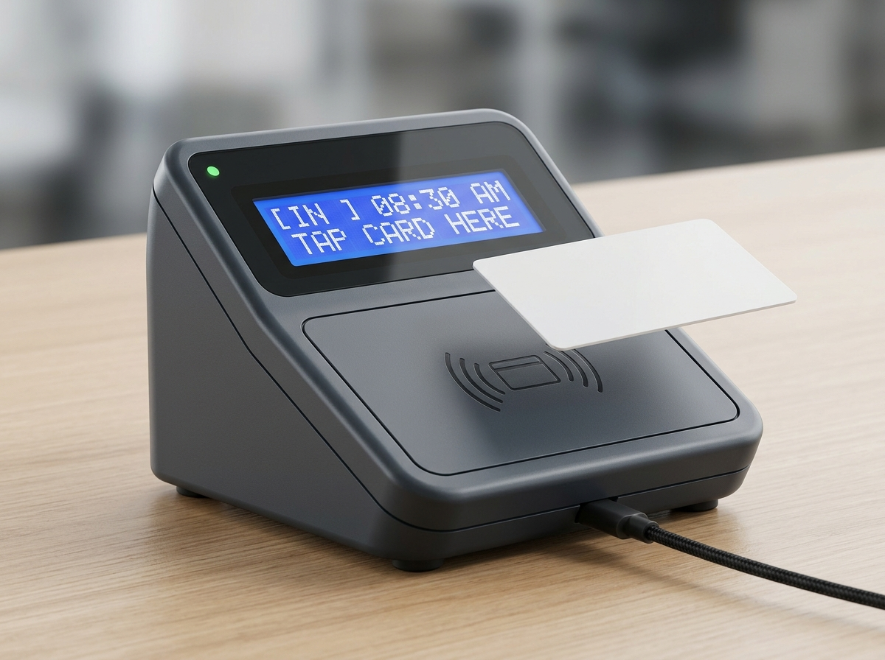

# ESP32 + RC522 RFID Attendance System

[](https://www.espressif.com/)
[](https://www.arduino.cc/)
[](https://github.com/miguelbalboa/rfid)
[](https://github.com/johnrickman/LiquidCrystal_I2C)
[](#key-features)
[](LICENSE)

A complete, production-ready, standalone RFID attendance terminal powered by an **ESP32** microcontroller, an **MFRC522** 13.56 MHz RFID reader, and an **I2C 16x2 LCD display**.

The terminal broadcasts its own **Wi-Fi Access Point** with a built-in **DNS Captive Portal** and serves an interactive **Material Design 3 Kiosk Web Application** directly from the ESP32 internal flash memory. 

> **Zero Cloud & Zero External Hardware RTC:** No internet connection, no routers, no external servers, and no coin-battery RTC hardware modules (DS3231/DS1307) are required. Time is synchronized in 1 click directly from the administrator's phone or computer browser.

---

## Hardware Terminal Concept



*Concept rendering of the portable desktop enclosure featuring the ESP32 core, MFRC522 RFID tap zone, 16x2 LCD character screen, and audio-visual feedback.*

---

## Table of Contents

1. [Key Features](#key-features)
2. [Hardware Components & Pinout](#hardware-components--pinout)
3. [Wiring Diagram](#wiring-diagram)
4. [Arduino IDE Setup & Installation](#arduino-ide-setup--installation)
5. [Step-by-Step Usage Guide](#step-by-step-usage-guide)
   - [1. Connect to Wi-Fi Access Point](#1-connect-to-wi-fi-access-point)
   - [2. Time Sync & Session Setup](#2-time-sync--session-setup)
   - [3. Register RFID Cards / Tags](#3-register-rfid-cards--tags)
   - [4. Running Attendance (IN & OUT Modes)](#4-running-attendance-in--out-modes)
   - [5. Exporting CSV Attendance Reports](#5-exporting-csv-attendance-reports)
6. [REST API Reference](#rest-api-reference)
7. [Repository File Structure](#repository-file-structure)
8. [Troubleshooting & Diagnostics](#troubleshooting--diagnostics)
9. [License](#license)

---

## Key Features

- **All-in-One Self-Contained Firmware:** The C++ microcontroller logic, Wi-Fi AP, DNS server, REST API endpoints, LittleFS history, NVS persistence, and the complete Material Design 3 frontend (HTML5/CSS3/JavaScript/Web Audio synthesis) reside in a single optimized sketch.
- **Standalone Wi-Fi Hotspot & Captive Portal:** Broadcasts `ESP32-Attendance` on `192.168.4.1`. Connecting smartphones and laptops automatically trigger the captive portal prompt and open the dashboard without requiring an IP address lookup.
- **Split-Screen Kiosk Console (60% / 40%):**
  - **60% RFID Tap Sensor View:** Interactive animated radar pulse rings, greeting prompts, and large scan confirmation panels with 1.5-second auto-reset.
  - **40% Live Attendance Roster:** Real-time searchable roster table displaying Attendee Name, Student/Employee ID, Card UID, Time IN, Time OUT, and status badges.
- **Hardware I2C 16x2 Character LCD:**
  - Auto-probes I2C addresses `0x27` and `0x3F`.
  - **Row 0:** Centered `TIME IN` or `TIME OUT`.
  - **Row 1:** Attendee formatted as `SURNAME, Initial.` (e.g., `DELA CRUZ, J.`) displayed for 1.5 seconds.
  - **Idle State:** Displays live 12-hour clock, active session direction (`[IN]` or `[OUT]`), and card tap instructions.
- **Strict Deduplication ("Repeated Cards Listed as ONE"):**
  - Each individual attendee is maintained as **exactly one unique row** in the roster table.
  - Duplicate taps in the same direction are caught and acknowledged with amber warnings and audio blips without creating duplicate entries.
  - Switching between Entrance and Exit updates the existing attendee's timestamp and sets status to `Completed`.
- **Software Crystal Clock (No Hardware RTC Required):** 1-click synchronization button reads the local UNIX epoch timestamp and timezone offset directly from the administrator's device.
- **Two-Step RFID Card Registration:**
  - Enter student/employee name and ID number in the web modal, then tap the card to pair.
  - Permanently saved in ESP32 non-volatile storage (NVS Preferences), retained across power cycles.
- **Session History & Instant CSV Export:**
  - Stores past session records in ESP32 LittleFS flash filesystem.
  - Instant one-click CSV download for Excel, Google Sheets, or institutional databases.
- **Enhanced RF Sensitivity:** Configured with maximum hardware antenna gain (`RxGain_max`, 48 dB) for fast, reliable reads through phone cases and keychains.

---

## Hardware Components & Pinout

### Required Parts
1. **ESP32 Dev Module** (30-pin or 38-pin ESP-WROOM-32)
2. **MFRC522 13.56 MHz RFID Reader Module** + RFID Cards / Key Fobs (13.56 MHz Mifare Classic / Ultralight / NTAG)
3. **16x2 LCD Display with I2C Backpack** (PCFL8574 chip, address `0x27` or `0x3F`)
4. Micro-USB or USB-C Cable (for power and programming)
5. Jumper wires (female-to-female and female-to-male)

---

### Pin Connection Tables

#### 1. MFRC522 RFID Reader (SPI Interface)
| RC522 Pin | ESP32 Pin | Wire Color Recommendation | Notes |
| :--- | :--- | :--- | :--- |
| **3.3V (VCC)** | **3V3** | Red | **CRITICAL: Connect to 3.3V ONLY! 5V will permanently damage the RC522.** |
| **RST** | **GPIO 4** | Orange | Reset Pin *(Moved to GPIO 4 to free GPIO 22 for I2C SCL)* |
| **GND** | **GND** | Black | Common Ground |
| **IRQ** | *(Unused)* | -- | Not connected (software polling mode) |
| **MISO** | **GPIO 19** | Blue | VSPI MISO |
| **MOSI** | **GPIO 23** | Green | VSPI MOSI |
| **SCK** | **GPIO 18** | Yellow | VSPI SCK |
| **SDA (SS)** | **GPIO 5** | Purple | VSPI Slave Select / Chip Select |

#### 2. I2C 16x2 LCD Display (I2C Interface)
| LCD I2C Pin | ESP32 Pin | Wire Color Recommendation | Notes |
| :--- | :--- | :--- | :--- |
| **GND** | **GND** | Black | Common Ground |
| **VCC** | **VIN / 5V** | Red | Connect to 5V (standard HD44780 contrast requires 5V) |
| **SDA** | **GPIO 21** | Blue | Hardware I2C SDA |
| **SCL** | **GPIO 22** | Yellow | Hardware I2C SCL *(Address auto-probed: 0x27 or 0x3F)* |

#### 3. Status LED
| Component | ESP32 Pin | Notes |
| :--- | :--- | :--- |
| **Built-in Blue LED** | **GPIO 2** | Automatically blinks on valid card read, registration, or error |

---

## Wiring Diagram

```text
                  +-----------------------------------+
                  |            ESP32 DEVKIT           |
                  |                                   |
    [3.3V] <------+ 3V3                           GND +------> [GND Common]
    [GND]  <------+ GND                          GPIO 23 +------> RC522 MOSI
    [RST]  <------+ GPIO 4                       GPIO 19 +------> RC522 MISO
    [SDA]  <------+ GPIO 5 (SS)                  GPIO 18 +------> RC522 SCK
                  |                              GPIO 21 +------> LCD SDA
                  |                              GPIO 22 +------> LCD SCL
    [5V]   <------+ VIN                           GPIO 2 +------> Onboard LED
                  +-----------------------------------+
```

---

## Arduino IDE Setup & Installation

### Step 1: Install ESP32 Board Package
1. Open **Arduino IDE** (version 2.0 or newer).
2. Go to **File -> Preferences**.
3. Under **Additional boards manager URLs**, add:
   ```text
   https://raw.githubusercontent.com/espressif/arduino-esp32/gh-pages/package_esp32_index.json
   ```
4. Open **Tools -> Board -> Boards Manager...**, search for `esp32` by **Espressif Systems**, and click **Install**.

### Step 2: Install Required Libraries
Open **Tools -> Manage Libraries...** (`Ctrl + Shift + I`) and install:
1. **MFRC522** by *GithubCommunity* (Miguel Balboa)
2. **LiquidCrystal_I2C** by *Frank de Brabander* (or Marco Schwartz)

### Step 3: Configure Board Settings & Upload
1. Open `ESP32_RFID_Attendance/ESP32_RFID_Attendance.ino` in Arduino IDE.
2. Select your board: **Tools -> Board -> esp32 -> ESP32 Dev Module**.
3. Select your serial port: **Tools -> Port -> COMx** (e.g., `COM3`, `COM7`).
4. Set **Upload Speed**: `921600` (for fast flashing).
5. Click **Upload** (`Ctrl + U`).
6. Once completed, open **Tools -> Serial Monitor** at baud rate **115200** to view diagnostics.

---

## Step-by-Step Usage Guide

### 1. Connect to Wi-Fi Access Point
1. Power up the ESP32 via power bank, USB adapter, or computer.
2. On your mobile phone, tablet, or laptop, connect to the Wi-Fi network:
   - **SSID:** `ESP32-Attendance`
   - **Password:** `12345678`
3. A **Sign in to Wi-Fi network** captive portal banner will automatically appear. Tap it to open the console.
4. If it does not appear automatically, open any browser (Chrome, Safari, Edge, Firefox) and navigate to:
   ```text
   http://192.168.4.1
   ```

### 2. Time Sync & Session Setup
1. On fresh boot, the **Onboarding Setup Modal** appears automatically.
2. Click **⚡ Sync Device Time Now (1-Click)**. The ESP32 crystal clock synchronizes instantly with your phone's local time.
3. Select the session direction: **Entrance (IN)** or **Exit (OUT)**.
4. Enter a session title (e.g., *CS101 Morning Lecture*) and click **Start Attendance**.

### 3. Register RFID Cards / Tags
1. Click the **⚙️ Settings** icon in the top bar.
2. Go to the **➕ Register Tag** tab.
3. Fill in the attendee's **Full Name** (e.g., *Juan Dela Cruz*) and optional **Student / Employee ID** (e.g., *2026-0042*).
4. Click **Confirm & Tap Card**.
5. The reader enters registration mode for 30 seconds. Tap the card against the RC522 sensor.
6. The ESP32 beeps/chimes, flashes the blue LED, displays `TAG REGISTERED` on the LCD, and permanently saves the record to flash memory.

### 4. Running Attendance (IN & OUT Modes)
1. Ensure the session status shows **ACTIVE**.
2. Have attendees tap their cards against the terminal:
   - **LCD Screen:** Shows centered `TIME IN` or `TIME OUT` with `SURNAME, Initial.` for 1.5 seconds.
   - **Web App Console:** The left panel animates green with the attendee's name and timestamp, playing an audio chime.
   - **Roster Table:** The attendee row is created or updated with their exact timestamp.
   - **Repeated Scans:** If an attendee taps twice in the same direction, the system displays an amber notice (`ALREADY LOGGED`) and preserves their original timestamp without creating duplicate rows.
3. To switch between Entrance and Exit, click **🔄 Switch to Exit Mode** in the top bar or session menu.

### 5. Exporting CSV Attendance Reports
- **Session Roster CSV:** Click **📥 Export CSV** in the Live Attendance tab to download `attendance_log.csv` (Columns: Index, Full Name, ID Number, Card UID, Time IN, Time OUT, Status, Session Title).
- **Cards Database CSV:** In Settings -> Registered Database, click **📥 Export Cards CSV** to download `registered_cards.csv`.

---

## REST API Reference

The ESP32 hosts a built-in REST API accessible on port `80`:

| Endpoint | Method | Parameters | Description |
| :--- | :--- | :--- | :--- |
| `/` | `GET` | None | Serves the full single-page web app |
| `/api/status` | `GET` | None | Returns JSON object with clock, session state, attendee count, and last scan |
| `/api/time` | `POST` | `epoch`, `tz_offset` | Sets ESP32 internal clock to given epoch and timezone |
| `/api/session/start` | `POST` | `title`, `type`, `clear_previous` | Starts a new attendance session |
| `/api/session/stop` | `POST` | None | Stops current attendance session |
| `/api/session/toggle_mode` | `POST` | None | Toggles session between `Entrance` and `Exit` |
| `/api/session/clear` | `POST` | None | Clears all attendee records from current session roster |
| `/api/session/save_history` | `POST` | None | Archives active session records into LittleFS flash |
| `/api/session/history` | `GET` | None | Returns list of archived sessions from LittleFS |
| `/api/attendance` | `GET` | None | Returns JSON array of recorded attendees in active session |
| `/api/attendance/export.csv`| `GET` | None | Streams downloadable CSV spreadsheet of session roster |
| `/api/register/start` | `POST` | `name`, `student_id` | Enters 30-second card registration mode |
| `/api/register/status` | `GET` | None | Polls registration status and returns captured UID |
| `/api/register/cancel` | `POST` | None | Cancels active registration mode |
| `/api/cards` | `GET` | None | Returns JSON array of all registered cards stored in NVS |
| `/api/cards/delete` | `POST` | `uid` | Deletes a registered card from flash storage |
| `/api/cards/clear` | `POST` | None | Deletes all registered cards from flash storage |
| `/api/cards/export.csv` | `GET` | None | Streams downloadable CSV file of all registered tags |
| `/api/settings` | `POST` | `require_registration` | Configures system policies (1 = reject unknown, 0 = allow) |

---

## Repository File Structure

```text
ESP32-RFID-Attendance-System/
├── .gitignore                                  # Git exclusion list (build artifacts, temp files)
├── LICENSE                                     # MIT Open-Source License
├── README.md                                   # Comprehensive documentation & hardware guide
├── ESP32_RFID_Attendance/
│   └── ESP32_RFID_Attendance.ino               # Complete standalone firmware sketch
├── assets/
│   └── attendance_terminal_enclosure_concept.jpg # Hardware enclosure 3D concept render
├── web_preview/
│   └── test_page.html                          # Interactive browser preview for UI styling/testing
└── tools/
    └── upload_to_esp32.bat                     # Quick one-click command-line upload script
```

---

## Troubleshooting & Diagnostics

### 1. Serial Monitor Shows `Reader communication failed! Version: 0x00 or 0xFF`
- Verify wiring connections. Loose jumper wires are the most frequent cause.
- **VCC MUST be connected to 3.3V.** Connecting to 5V can fry the RC522 chip.
- Double-check SPI pins: MISO = GPIO 19, MOSI = GPIO 23, SCK = GPIO 18, SDA/SS = GPIO 5, RST = GPIO 4.

### 2. Captive Portal Doesn't Automatically Appear on Phone
- Some Android/iOS devices require tapping the "Sign in to network" notification.
- If your phone has cellular data enabled, temporarily turn mobile data off so your browser does not route requests through 4G/5G.
- Manually open Chrome, Safari, or Edge and go to `http://192.168.4.1`.

### 3. LCD Screen Displays Black Boxes or No Text
- Adjust the blue potentiometer on the back of the I2C backpack using a small screwdriver to set display contrast.
- Ensure the LCD is powered from **VIN / 5V** (3.3V is insufficient for standard HD44780 LCD contrast).

### 4. Card Tap Ignored / Access Denied
- Ensure the attendance session is **ACTIVE** (click Start Session).
- If **Strict Registration Mode** is enabled in Settings, the card must first be enrolled under the Register Tag tab.
- If the card was already scanned in this direction, it is flagged as duplicate to preserve clean data.

### 5. Time Resets After Reboot
- Because the system uses software RTC rather than a coin-cell battery module, time initializes to unset after a cold restart.
- Simply click **⚡ Sync Device Time** in the web dashboard upon powering on.

---

## License

This project is open-source and released under the [MIT License](LICENSE). Feel free to use, modify, and distribute for educational, personal, or commercial purposes.
