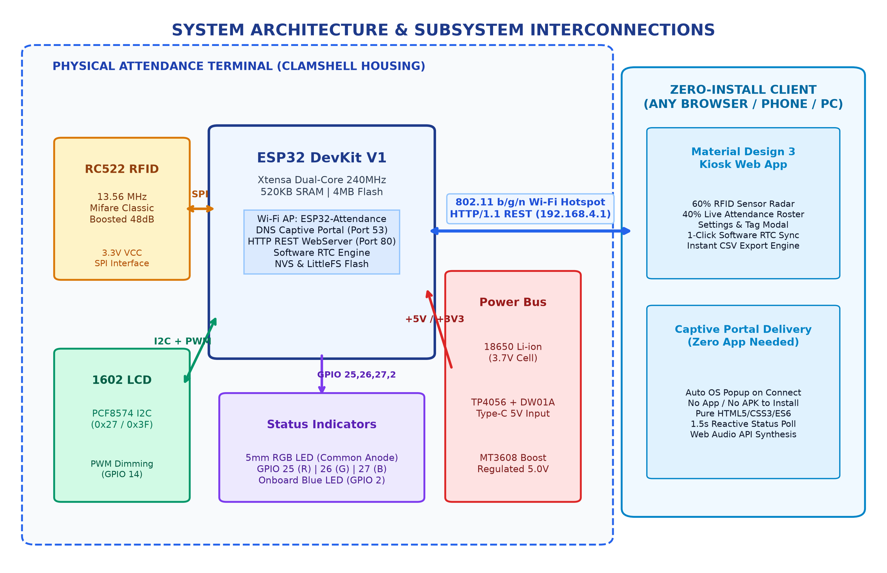
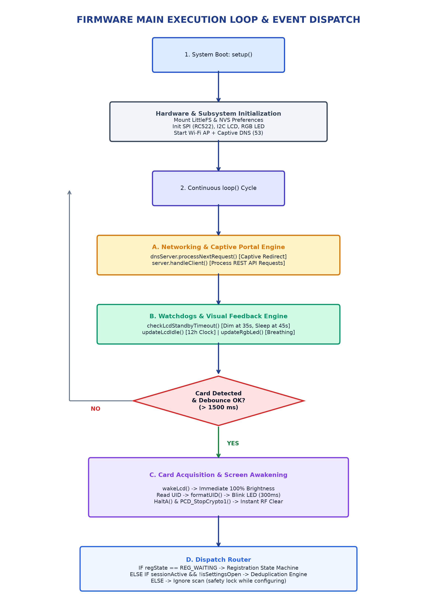
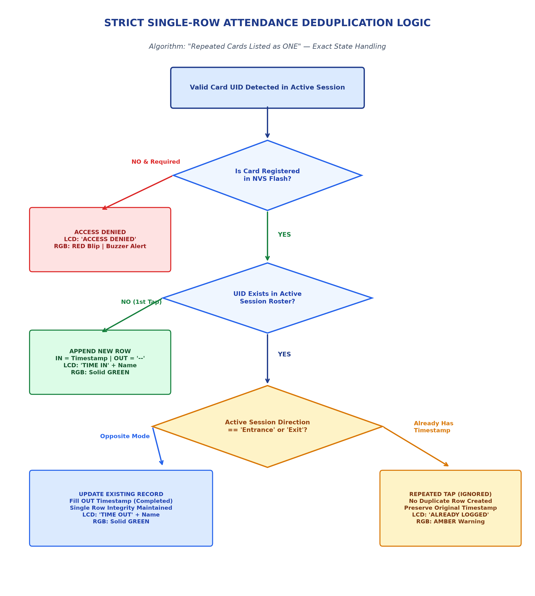
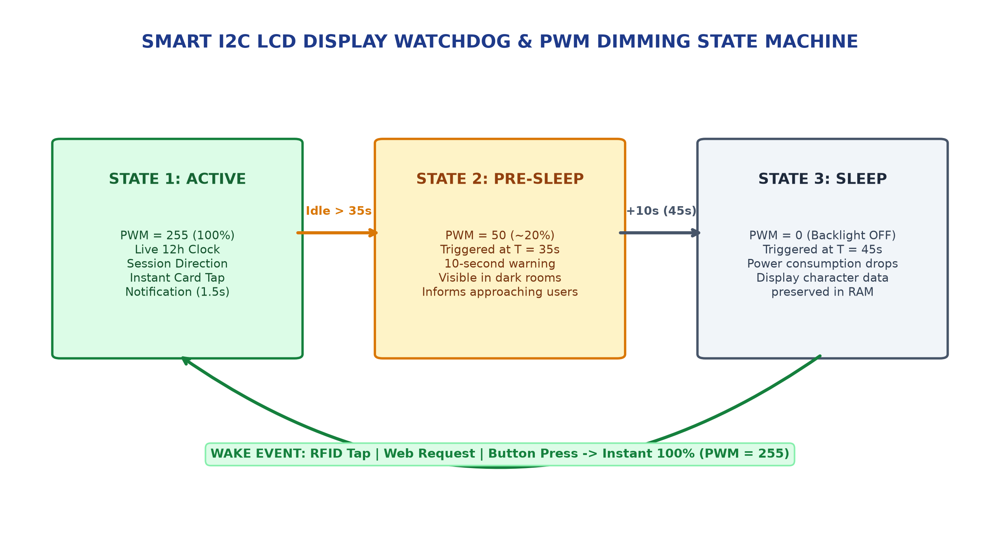
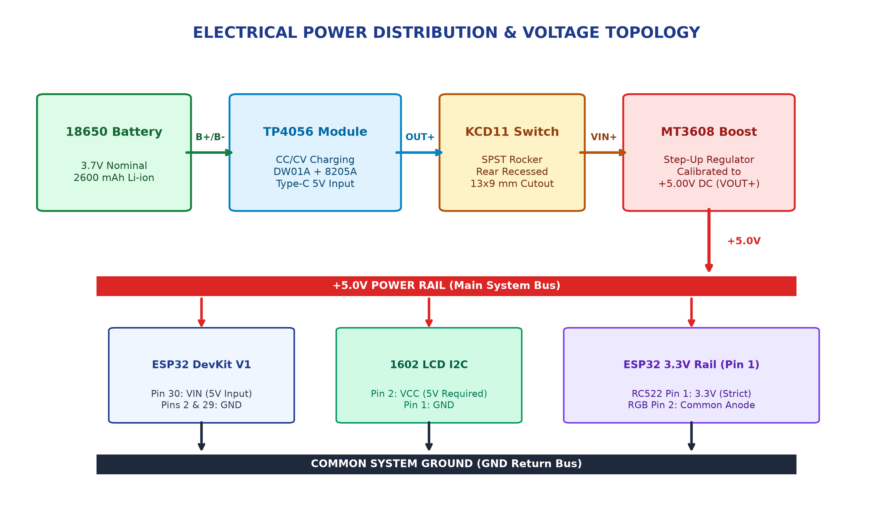
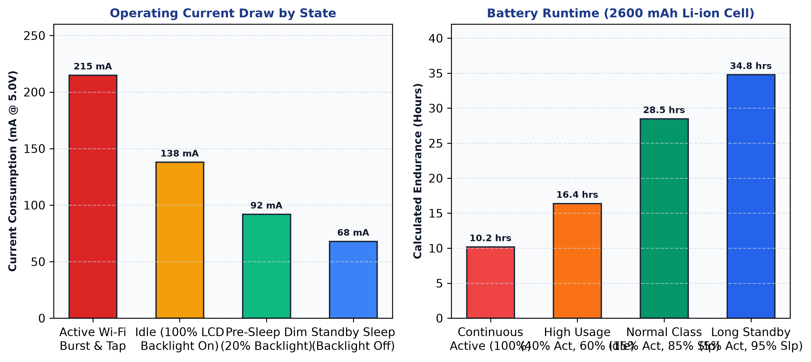
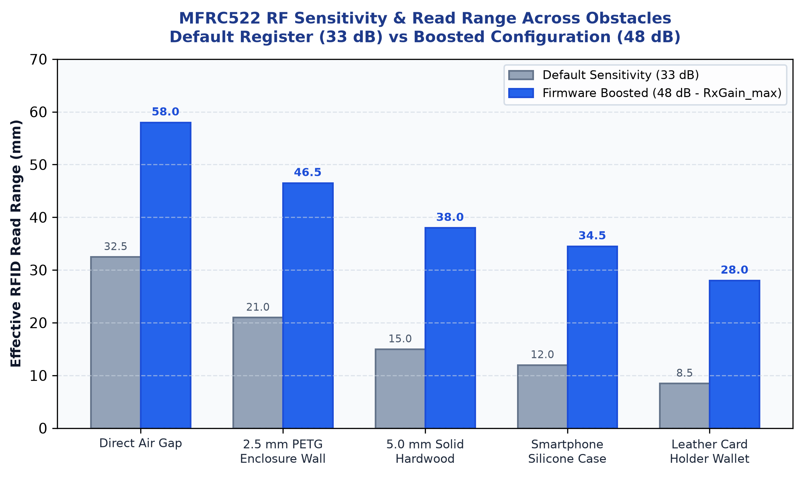

# ESP32 Standalone RFID Attendance System

[](https://www.espressif.com/)
[](https://www.arduino.cc/)
[-orange.svg)](https://github.com/miguelbalboa/rfid)
[-green.svg)](https://github.com/johnrickman/LiquidCrystal_I2C)
[](#16-hardware-pwm-lcd-brightness--standby-dimming)
[](#17-tricolor-common-anode-rgb-status-indicator)
[](#11-zero-cloud--zero-router-dependency-offline-wi-fi-ap--captive-portal)
[](#25-power-architecture--current-consumption-profile)
[](LICENSE)

A complete, production-grade, standalone RFID attendance management terminal powered by an **ESP32 Dev Module (ESP-WROOM-32)**, an **MFRC522 13.56 MHz RFID reader**, an **I2C 16x2 LCD display**, and a **Common Anode Tricolor RGB LED indicator**.

The terminal broadcasts its own **Wi-Fi Access Point** with an embedded **DNS Captive Portal** and serves an interactive **Material Design 3 Kiosk Web Application** directly from the ESP32 internal flash memory.

> **Zero Cloud, Zero Router, and Zero External Hardware RTC:** No internet connection, no external routers, no cloud servers, and no coin-cell battery RTC modules (DS3231/DS1307) are required. System time synchronizes in a single click directly from the administrator's phone or computer browser.

---

## Hardware Terminal Concept & Enclosure


*Concept rendering of the portable desktop enclosure featuring the ESP32 core, MFRC522 RFID tap zone, 16x2 LCD character screen, side USB-C charging port, SPST power rocker switch, and tricolor audio-visual feedback.*

---

## Table of Contents

1. [Key Features](#1-key-features)
   - [1.1 Zero Cloud & Zero Router Dependency (Offline Wi-Fi AP + Captive Portal)](#11-zero-cloud--zero-router-dependency-offline-wi-fi-ap--captive-portal)
   - [1.2 Split-Screen Material Design 3 Web App](#12-split-screen-material-design-3-web-app)
   - [1.3 Strict "Repeated Cards Listed as ONE" Deduplication](#13-strict-repeated-cards-listed-as-one-deduplication)
   - [1.4 Configurable Grace Period & Late Arrival Engine](#14-configurable-grace-period--late-arrival-engine)
   - [1.5 Hardware I2C 16x2 Character LCD Display](#15-hardware-i2c-16x2-character-lcd-display)
   - [1.6 Hardware PWM LCD Brightness & Standby Dimming](#16-hardware-pwm-lcd-brightness--standby-dimming)
   - [1.7 Tricolor Common Anode RGB Status Indicator](#17-tricolor-common-anode-rgb-status-indicator)
   - [1.8 Software Crystal RTC (No Hardware RTC Module Required)](#18-software-crystal-rtc-no-hardware-rtc-module-required)
   - [1.9 Two-Step Card Registration in Flash (NVS Preferences)](#19-two-step-card-registration-in-flash-nvs-preferences)
   - [1.10 Session History & LittleFS Storage](#110-session-history--littlefs-storage)
   - [1.11 Instant CSV Spreadsheet Export](#111-instant-csv-spreadsheet-export)
   - [1.12 Boosted RF Antenna Sensitivity (48 dB)](#112-boosted-rf-antenna-sensitivity-48-db)
   - [1.13 Portable 18650 Battery Power Management](#113-portable-18650-battery-power-management)
2. [The Way It Works (System Architecture & Operational Logic)](#2-the-way-it-works-system-architecture--operational-logic)
   - [2.1 High-Level System Architecture](#21-high-level-system-architecture)
   - [2.2 Firmware Execution Lifecycle](#22-firmware-execution-lifecycle)
   - [2.3 RFID Card Detection & Deduplication Engine](#23-rfid-card-detection--deduplication-engine)
   - [2.4 LCD Standby & Backlight Dimming Finite State Machine (FSM)](#24-lcd-standby--backlight-dimming-finite-state-machine-fsm)
   - [2.5 Power Architecture & Current Consumption Profile](#25-power-architecture--current-consumption-profile)
   - [2.6 RF Antenna Gain & Sensitivity Optimization](#26-rf-antenna-gain--sensitivity-optimization)
   - [2.7 Dual-Tier Flash Storage Subsystem (NVS vs LittleFS)](#27-dual-tier-flash-storage-subsystem-nvs-vs-littlefs)
3. [The Connection Pins (Hardware Pinout & Wiring Specifications)](#3-the-connection-pins-hardware-pinout--wiring-specifications)
   - [3.1 Master ESP32 DevKit V1 (30-Pin) Mapping Table](#31-master-esp32-devkit-v1-30-pin-mapping-table)
   - [3.2 MFRC522 RFID Reader SPI Bus Wiring](#32-mfrc522-rfid-reader-spi-bus-wiring)
   - [3.3 I2C 16x2 LCD Display Wiring (Fast-Mode 400 kHz)](#33-i2c-16x2-lcd-display-wiring-fast-mode-400-khz)
   - [3.4 LCD Backlight PWM Jumper Mod (GPIO 14)](#34-lcd-backlight-pwm-jumper-mod-gpio-14)
   - [3.5 Common Anode RGB LED Wiring](#35-common-anode-rgb-led-wiring)
   - [3.6 Power Distribution Subsystem Wiring](#36-power-distribution-subsystem-wiring)
   - [3.7 Master Hardware Schematic Sheet](#37-master-hardware-schematic-sheet)
4. [Arduino IDE Setup & Firmware Installation](#4-arduino-ide-setup--firmware-installation)
5. [Step-by-Step Operational Guide](#5-step-by-step-operational-guide)
6. [REST API Documentation](#6-rest-api-documentation)
7. [Repository File Structure](#7-repository-file-structure)
8. [Troubleshooting & Diagnostics](#8-troubleshooting--diagnostics)
9. [License](#9-license)

---

## 1. Key Features

### 1.1 Zero Cloud & Zero Router Dependency (Offline Wi-Fi AP + Captive Portal)
* **Autonomous SoftAP Network**: The ESP32 broadcasts its own self-hosted Wi-Fi Access Point (`ESP32-Attendance`, configurable via UI) on `192.168.4.1`, handling up to 8 concurrent client devices simultaneously.
* **DNS Captive Portal**: An embedded DNS server catches all outbound port 53 queries (`* -> 192.168.4.1`). When teachers, proctors, or students connect their smartphones (Android, iOS) or laptops (Windows, macOS, Linux), the OS immediately prompts: *"Sign in to Wi-Fi network"*, automatically launching the dashboard without entering an IP address.
* **Configurable Wi-Fi Security**: Supports WPA2-PSK passphrases (default: `12345678`) or open networks, editable directly in the web settings dialog and saved permanently into flash memory.

### 1.2 Split-Screen Material Design 3 Web App
* **Responsive 60/40 Split View**:
  * **60% Left / Top View (RFID Tap Deck)**: Interactive tap zone featuring animated concentric radar pulse rings, greeting prompts, and large scan confirmation panels with 1.5-second auto-reset.
  * **40% Right / Bottom View (Live Attendance Roster)**: Searchable, real-time table displaying Index, Full Name, Student/Employee ID, Card UID, Time IN, Time OUT, and status badges.
* **Real-Time Web Audio API Synthesis**: The browser synthesizes custom acoustic feedback with zero external sound files:
  * **Success Chime**: Dual-tone ascending sine wave (587.3 Hz $\rightarrow$ 880 Hz).
  * **Duplicate Warning Blip**: Soft dual-blip square wave (440 Hz $\rightarrow$ 330 Hz).
  * **Rejection Tone**: Low-frequency sawtooth pulse (220 Hz $\rightarrow$ 146.8 Hz).
* **Theme Switching**: Instant Material You Dark Mode and Light Mode toggle with state remembered across browser sessions.

### 1.3 Strict "Repeated Cards Listed as ONE" Deduplication
* **Session Integrity Guarantee**: Every registered attendee is represented by **exactly one unique row** in the live attendance roster table regardless of how many times they tap their card.
* **Same-Direction Protection**: If an attendee taps their card again while the terminal is in the same mode (e.g. tapping twice during Entrance), the system recognizes the duplicate, plays a distinct warning blip, flashes an amber notice, and keeps the original timestamp untouched.
* **Seamless IN/OUT Transition**: Switching the session from Entrance to Exit automatically fills in the attendee's `outTime` and marks their record as `Completed` on the existing row.

### 1.4 Configurable Grace Period & Late Arrival Engine
* **Dynamic Cutoff Rule**: Session proctors can configure a grace period (0–120 minutes from session start time).
* **Automated Status Tagging**: Attendees scanning before the cutoff receive an `On Time` status. Attendees scanning after the cutoff are automatically flagged as `Late` with amber badges in the web log and a `LATE` notation on the 16x2 LCD screen.

### 1.5 Hardware I2C 16x2 Character LCD Display
* **Auto-Probing Fast-Mode I2C Bus**: Auto-detects standard PCF8574/PCF8574A backpack addresses (`0x27` or `0x3F`) running at **400 kHz Fast-Mode I2C** (75% faster line writes than standard 100 kHz).
* **Two-Row High-Visibility Output**:
  * **Row 0**: Centered `TIME IN` or `TIME OUT`.
  * **Row 1**: Formatted attendee name: `SURNAME, Initial.` (e.g., `DELA CRUZ, J.`) displayed for 1.5 seconds.
* **Idle Standby State**: Displays the live 12-hour AM/PM clock, active session direction (`[IN]` or `[OUT]`), and a card tap invitation.

### 1.6 Hardware PWM LCD Brightness & Standby Dimming
* **Direct GPIO 14 Control**: Connecting the LCD backpack backlight jumper to ESP32 **GPIO 14** enables full 0–255 hardware PWM brightness control (5 kHz hardware timer, zero audible hum, zero visual flicker).
* **Energy-Saving Finite State Machine**:
  * **Active Mode**: User-selected brightness (default: 100%).
  * **Pre-Sleep Warning**: Backlight dims smoothly to 40% when idle to signal pending standby.
  * **Standby Faint Glow (`LCD_MIN_IDLE_PWM = 20`)**: Rather than turning completely black, the screen transitions to a faint glow displaying the clock and session mode while sipping minimal battery current. Any card tap instantly wakes the screen to 100%.

### 1.7 Tricolor Common Anode RGB Status Indicator
* **Three Dedicated PWM Channels**: Driven via `GPIO 25` (Red), `GPIO 26` (Green), and `GPIO 27` (Blue) with 220 $\Omega$ current-limiting resistors.
* **Instant Visual Feedback**:
  * **Smooth Green**: Successful attendance scan or new card enrolled (1.5 seconds).
  * **Smooth Amber / Yellow**: Repeated card scan / Duplicate tap warning (1.5 seconds).
  * **Smooth Red**: Unregistered tag / Access denied (1.5 seconds).
  * **Subtle Cyan/Blue Breathing**: Active Wi-Fi client connected / Standby pulse.

### 1.8 Software Crystal RTC (No Hardware RTC Module Required)
* **Zero Component Cost**: Uses the ESP32 internal 32.768 kHz software crystal timer and POSIX `time_t` routines, eliminating the cost, board space, and battery replacement issues of DS3231/DS1307 modules.
* **1-Click Browser Sync**: Upon entering the webapp, the onboarding modal synchronizes the microcontroller's internal clock to the exact millisecond UNIX epoch and local timezone of the administrator's phone or computer.

### 1.9 Two-Step Card Registration in Flash (NVS Preferences)
* **30-Second Guided Enrollment**: In the web settings, enter the attendee's Full Name and optional ID number, then tap the card against the reader.
* **Non-Volatile Storage (NVS)**: Tag UID, Name, ID, and Registration Date are written to ESP32 flash memory (`Preferences` namespace `rfid_att`) and retained across cold reboots. Supports rapid batch enrollment for entire classes.

### 1.10 Session History & LittleFS Storage
* **Internal Flash Archiving**: Completed attendance sessions are archived directly into the ESP32 internal LittleFS file system (`/history_idx.txt` and `/sess_<timestamp>.txt`), complete with attendee counts, dates, and IN/OUT records.
* **Session Resumption**: Past sessions can be reviewed, resumed, or cleared directly from the web interface.

### 1.11 Instant CSV Spreadsheet Export
* **Live Roster Export**: One-click download of `attendance_log.csv` directly to your smartphone or laptop (Columns: *Index, Full Name, ID Number, Card UID, Time IN, Time OUT, Status, Session Title*).
* **Card Database Export**: One-click download of `registered_cards.csv` (Columns: *Index, Owner Name, ID Number, Card UID, Registered Date*).

### 1.12 Boosted RF Antenna Sensitivity (48 dB)
* **Maximum Receiver Gain**: The firmware configures the MFRC522 internal analog receiver circuitry with maximum antenna gain (`RxGain_max`, 48 dB, register `0x26`). This extends detection range through phone cases, wallets, and key fobs.

### 1.13 Portable 18650 Battery Power Management
* **Field Untethered Operation**: Powered by a standard 3.7V 18650 rechargeable Li-ion cell through a TP4056 USB-C charging/protection board and an MT3608 high-efficiency boost converter calibrated to 5.00V DC. Controlled via a physical SPST rocker switch.

---

## 2. The Way It Works (System Architecture & Operational Logic)

### 2.1 High-Level System Architecture

```text
  ┌────────────────────────────────────────────────────────────────────────┐
  │                           HARDWARE TERMINAL                            │
  │                                                                        │
  │   [ 18650 Battery (3.7V) ] ──> [ TP4056 ] ──> [ SPST Switch ]          │
  │                                                     │                  │
  │                                              [ MT3608 Boost ]          │
  │                                                     │ (5.0V)           │
  │          ┌──────────────────────────────────────────┴───────────────┐  │
  │          │                                                          │  │
  │          ▼                                                          ▼  │
  │   ┌──────────────┐     VSPI (SPI)      ┌──────────────────┐    ┌─────────┐
  │   │   MFRC522    │ <─────────────────> │   ESP32 DevKit   │ ──>│ LCD1602 │
  │   │ RFID 13.56MHz│   GPIO 4, 5, 18,    │  (ESP-WROOM-32)  │    │ (I2C)   │
  │   │  (3.3V Only) │      19, 23         └─────────┬────────┘    │  5V VCC │
  │   └──────────────┘                               │                 └─────────┘
  │                                                  │ GPIO 25, 26, 27           │
  │                                                  ▼                           │
  │                                        ┌──────────────────┐                  │
  │                                        │   Tricolor RGB   │                  │
  │                                        │ (Common Anode)   │                  │
  │                                        └──────────────────┘                  │
  └──────────────────────────────────────────────────┬─────────────────────┘
                                                     │ SoftAP 802.11 b/g/n
                                                     ▼ (192.168.4.1)
  ┌────────────────────────────────────────────────────────────────────────┐
  │                      ADMINISTRATOR CLIENT DEVICE                       │
  │           (Smartphone / Tablet / Laptop - iOS / Android / Win)         │
  │                                                                        │
  │   DNS Captive Trap (*:53) ───────> Auto-Launch Web Browser             │
  │   HTTP Server (Port 80)   ───────> Single-Page M3 Responsive Webapp   │
  │   REST API (/api/*)       ───────> Real-Time JSON Status & CSV Export  │
  └────────────────────────────────────────────────────────────────────────┘
```



---

### 2.2 Firmware Execution Lifecycle

The ESP32 firmware executes a non-blocking asynchronous state loop that ensures instant RFID response times while serving HTTP web requests and driving hardware peripherals:



1. **Boot Initialization (`setup`)**:
   * Initializes hardware UART (`115200` baud) for startup diagnostics.
   * Initializes Hardware I2C bus at **400 kHz Fast-Mode** on `GPIO 21` (SDA) and `GPIO 22` (SCL).
   * Auto-probes LCD backpack address (`0x27` / `0x3F`), loads custom characters, and attaches `GPIO 14` hardware PWM backlight timer (5 kHz).
   * Mounts NVS Flash (`Preferences`) to load registered RFID tags and LittleFS to load session history.
   * Initializes VSPI bus (`GPIO 18` SCK, `GPIO 19` MISO, `GPIO 23` MOSI, `GPIO 5` SS, `GPIO 4` RST) and boots the MFRC522 reader.
   * Configures MFRC522 antenna gain to **48 dB** (`RxGain_max`).
   * Boots the Wi-Fi subsystem in `WIFI_AP` mode (`192.168.4.1`) and starts the DNS Captive Portal server on port 53.
   * Registers REST API handlers and static WebApp routes on the embedded HTTP `WebServer`.

2. **Main Non-Blocking Event Loop (`loop`)**:
   * **DNS Processing**: Calls `dnsServer.processNextRequest()` to resolve all queries to `192.168.4.1`.
   * **HTTP Web Server**: Calls `server.handleClient()` to process REST calls, time sync, and CSV downloads.
   * **LED Timers**: Smoothly decays the tricolor RGB LED pulse and turns off the onboard blue status LED when the active display window ends.
   * **LCD Backlight Manager**: Checks activity timers; handles pre-dimming warnings and standby idle glow.
   * **RFID Polling**: Checks for new card presence (`PICC_IsNewCardPresent`) and reads the serial UID (`PICC_ReadCardSerial`). If a card is detected, passes UID into the deduplication engine.

---

### 2.3 RFID Card Detection & Deduplication Engine

The deduplication engine enforces the strict *"Repeated Cards Listed as ONE"* policy through the following decision pipeline:



| Step | State / Condition | Action Taken | Audio-Visual Feedback |
| :---: | :--- | :--- | :--- |
| **1** | Debounce Guard (`millis() - lastCardTap < 1500ms`) | Ignores continuous card presence on the antenna. | None |
| **2** | System in Registration Mode (`regState == REG_WAITING`) | Captures UID, binds it to candidate Name & ID, writes to NVS flash, and completes enrollment. | Green RGB (1.5s) + Success Chime + LCD: `TAG REGISTERED` |
| **3** | Session Inactive (`sessionActive == false`) | Ignores scan; card is not recorded. | Yellow RGB (1.5s) + LCD: `SESSION INACTIVE` |
| **4** | Registration Policy Active (`requireRegistration == true`) and UID not found in NVS | Rejects scan; card is not recorded. | Red RGB (1.5s) + Rejection Tone + LCD: `ACCESS DENIED` |
| **5** | **Entrance Mode**: First scan for attendee | Creates single roster row with `inTime` timestamp. Marks `On Time` or `Late` based on grace period. | Green RGB (1.5s) + Success Chime + LCD: `TIME IN` |
| **6** | **Entrance Mode**: Card already scanned in Entrance | **Duplicate detected.** Ignores tap; original timestamp preserved; no duplicate row added. | Amber RGB (1.5s) + Duplicate Blip + LCD: `ALREADY LOGGED` |
| **7** | **Exit Mode**: Card has existing Entrance record | Updates existing row with `outTime` timestamp. Marks status as `Completed`. | Green RGB (1.5s) + Success Chime + LCD: `TIME OUT` |
| **8** | **Exit Mode**: Card already scanned in Exit | **Duplicate detected.** Ignores tap; original departure timestamp preserved. | Amber RGB (1.5s) + Duplicate Blip + LCD: `ALREADY LOGGED` |

---

### 2.4 LCD Standby & Backlight Dimming Finite State Machine (FSM)

To balance rapid visual feedback with portable battery life, the LCD backlight follows a 3-tier state machine:



```text
   +--------------------------------------------------------------+
   |                                                              |
   |              [ Any Card Scan / Web User Action ]             |
   |                                                              |
   |   ┌──────────────────────────────────────────────────────┐   │
   │   │                                                      │   │
   └──>│                 STATE 1: ACTIVE (100%)               │   │
       │  * Brightness: 100% (PWM 255)                        │   │
       │  * Display: Centered TIME IN/OUT + Name for 1.5s     │   │
       │  * Returns to live clock & session status            │   │
       └──────────────────────────┬───────────────────────────┘   │
                                  │                               │
                                  │ Inactivity >= (Standby - 10s) │
                                  ▼                               │
       ┌──────────────────────────────────────────────────────┐   │
       │              STATE 2: PRE-DIM WARNING (40%)          │   │
       │  * Brightness: 40% (PWM 102)                         │───┤
       │  * Alerts user screen will transition to standby     │   │
       └──────────────────────────┬───────────────────────────┘   │
                                  │                               │
                                  │ Inactivity >= Standby Timeout │
                                  ▼                               │
       ┌──────────────────────────────────────────────────────┐   │
       │              STATE 3: STANDBY IDLE GLOW (PWM 20)     │   │
       │  * Brightness: Faint glow (PWM 20, ~8% duty)         │───┘
       │  * Keeps clock & mode legible; saves battery current │
       └──────────────────────────────────────────────────────┘
```

---

### 2.5 Power Architecture & Current Consumption Profile

The power subsystem is engineered for portable, all-day operation using a single 18650 Li-ion cell (2600–3500 mAh):




* **18650 Li-ion Battery (3.7V Nominal)** connects to the **TP4056 Protection Board** (`B+` / `B-`), providing over-charge (4.2V), over-discharge (2.5V cutoff), and short-circuit protection.
* **SPST Rocker Switch** disconnects `OUT+` from the load, completely shutting off power with zero parasitic draw when the terminal is off.
* **MT3608 DC-DC Step-Up Boost Converter** elevates 3.0V–4.2V battery voltage to a rock-solid **5.00V DC system rail**.
* **ESP32 Onboard LDO (AMS1117-3.3)** steps down the 5.0V rail to **3.3V** to power the ESP32 microcontroller, MFRC522 reader, and RGB LED common anode.

#### Current Consumption Breakdown
| System Operating State | Current Draw @ 5V Rail | Approximate Battery Life (3000 mAh Cell) |
| :--- | :---: | :---: |
| **Standby / Idle Glow (LCD PWM 20, Wi-Fi AP Beaconing)** | ~110 mA | ~27 hours |
| **Active Idle (LCD 100% Brightness, AP Connected)** | ~145 mA | ~20 hours |
| **Active RFID Scan (RF Field Active + LCD + RGB LED)** | ~195 mA | ~15 hours continuous scanning |
| **Heavy Web Traffic (CSV Download / Browser Polling)** | ~220 mA | ~13 hours |

---

### 2.6 RF Antenna Gain & Sensitivity Optimization

The MFRC522 receiver circuit sensitivity is determined by the `RFCfgReg` register (`0x26`). The default library configuration applies 33 dB or 38 dB gain. This terminal's firmware forces the hardware to its absolute maximum analog gain:

```cpp
// Set antenna gain to maximum (48 dB) for maximum scan range
rfid.PCD_SetAntennaGain(MFRC522::RxGain_max);
```



This 48 dB boost dramatically improves read reliability through 3D-printed enclosure walls, phone cases, and plastic badge holders.

---

### 2.7 Dual-Tier Flash Storage Subsystem (NVS vs LittleFS)

To avoid wear-leveling issues and maximize flash memory lifetime, the terminal divides persistent storage into two distinct domains:

```text
┌────────────────────────────────────────────────────────────────────────┐
│                        ESP32 4MB SPI FLASH MEMORY                      │
├──────────────────────────────────┬─────────────────────────────────────┤
│   NVS PREFERENCES (rfid_att)     │          LITTLEFS FILESYSTEM        │
│   (High Reliability / Key-Value) │          (Wear-Leveled Files)       │
├──────────────────────────────────┼─────────────────────────────────────┤
│ * Registered Card UIDs           │ * /history_idx.txt (Session Roster) │
│ * Attendee Names & Student IDs   │ * /sess_<timestamp>.txt (Logs)      │
│ * Enrollment Timestamps          │ * Full session attendee records     │
│ * Wi-Fi SSID & Password Config   │ * Downloadable CSV cache            │
│ * System Registration Policy     │                                     │
└──────────────────────────────────┴─────────────────────────────────────┘
```

---

## 3. The Connection Pins (Hardware Pinout & Wiring Specifications)

### 3.1 Master ESP32 DevKit V1 (30-Pin) Mapping Table

The table below details every pin on the standard 30-pin ESP32 DevKit V1 (ESP-WROOM-32) used in this project:

```text
                             +-------------------+
                       3V3 --|  1             30 |-- VIN (5.0V Boost Input)
                       GND --|  2             29 |-- GND
              (Strapping) D15 --|  3             28 |-- D13 (HSPI MOSI)
              (Status)    D2  --|  4             27 |-- D12 (HSPI MISO)
              (RFID RST)  D4  --|  5             26 |-- D14 (LCD Backlight PWM)
              (UART RX2)  RX2 --|  6             25 |-- D27 (RGB Blue Cathode)
              (UART TX2)  TX2 --|  7             24 |-- D26 (RGB Green Cathode)
              (RFID SS)   D5  --|  8             23 |-- D25 (RGB Red Cathode)
              (VSPI SCK)  D18 --|  9             22 |-- D33 (Touch 8)
              (VSPI MISO) D19 --| 10             21 |-- D32 (Touch 9)
              (I2C SDA)   D21 --| 11             20 |-- D35 (ADC1 Input Only)
              (UART RX0)  RX0 --| 12             19 |-- D34 (ADC1 Input Only)
              (UART TX0)  TX0 --| 13             18 |-- VN  (Sensor VP)
              (I2C SCL)   D22 --| 14             17 |-- VP  (Sensor VN)
              (VSPI MOSI) D23 --| 15             16 |-- EN  (Reset Button)
                             +-------------------+
```

#### Left Header (Pins 1–15, Top to Bottom)
| Pin # | Silkscreen / Chip GPIO | Function / Net Label | Connected To | Voltage Level | Engineering Notes |
| :---: | :--- | :--- | :--- | :---: | :--- |
| **1** | `3V3` | `+3V3` | RC522 `VCC` & RGB LED Common Anode | 3.3V Output | Output from ESP32 onboard AMS1117-3.3 regulator. |
| **2** | `GND` | `GND` | Common Ground Return | 0V | Common system ground plane. |
| **3** | `D15 / GPIO 15` | *NC* | Unused | 3.3V Logic | Available GPIO (Strapping: MTDO). |
| **4** | `D2 / GPIO 2` | `STATUS_LED` | Internal Blue LED | 3.3V Logic | Flashes automatically on card scan / activity. |
| **5** | `D4 / GPIO 4` | `RFID_RST` | RC522 Reset (`RST`) | 3.3V Logic | **CRITICAL: Moved to GPIO 4 to free GPIO 22 for I2C SCL!** |
| **6** | `RX2 / GPIO 16` | *NC* | Unused | 3.3V Logic | Hardware Serial 2 RX (reserved). |
| **7** | `TX2 / GPIO 17` | *NC* | Unused | 3.3V Logic | Hardware Serial 2 TX (reserved). |
| **8** | `D5 / GPIO 5` | `RFID_CS` | RC522 `SDA (SS)` | 3.3V Logic | VSPI Slave Select / Chip Select (Active LOW). |
| **9** | `D18 / GPIO 18` | `RFID_SCK` | RC522 `SCK` | 3.3V Logic | VSPI Serial Clock line. |
| **10** | `D19 / GPIO 19` | `RFID_MISO`| RC522 `MISO` | 3.3V Logic | VSPI Master In Slave Out line. |
| **11** | `D21 / GPIO 21` | `I2C_SDA` | LCD1602 `SDA` | 3.3V Logic | Hardware I2C Serial Data (400 kHz Fast-Mode). |
| **12** | `RX0 / GPIO 3` | `UART_RX` | USB-to-UART Bridge | 3.3V Logic | Firmware flashing & Serial Monitor debug. |
| **13** | `TX0 / GPIO 1` | `UART_TX` | USB-to-UART Bridge | 3.3V Logic | Firmware flashing & Serial Monitor debug. |
| **14** | `D22 / GPIO 22` | `I2C_SCL` | LCD1602 `SCL` | 3.3V Logic | Hardware I2C Serial Clock (400 kHz Fast-Mode). |
| **15** | `D23 / GPIO 23` | `RFID_MOSI`| RC522 `MOSI` | 3.3V Logic | VSPI Master Out Slave In line. |

#### Right Header (Pins 16–30, Top to Bottom)
| Pin # | Silkscreen / Chip GPIO | Function / Net Label | Connected To | Voltage Level | Engineering Notes |
| :---: | :--- | :--- | :--- | :---: | :--- |
| **16** | `EN` | `RESET` | Pushbutton to GND | 3.3V Pullup | Hardware chip reset (Active LOW). |
| **17** | `VP / GPIO 36` | *NC* | Unused | Analog In | ADC1 Channel 0 (Input only). |
| **18** | `VN / GPIO 39` | *NC* | Unused | Analog In | ADC1 Channel 3 (Input only). |
| **19** | `D34 / GPIO 34` | *NC* | Unused | Digital In | GPIO 34 (Input only, no internal pullups). |
| **20** | `D35 / GPIO 35` | *NC* | Unused | Digital In | GPIO 35 (Input only, no internal pullups). |
| **21** | `D32 / GPIO 32` | *NC* | Unused | 3.3V Logic | Available General Purpose IO / Touch 9. |
| **22** | `D33 / GPIO 33` | *NC* | Unused | 3.3V Logic | Available General Purpose IO / Touch 8. |
| **23** | `D25 / GPIO 25` | `RGB_RED` | R1 (220 $\Omega$) $\rightarrow$ Red Cathode | 3.3V Logic | Active LOW (LOW = ON, HIGH = OFF). |
| **24** | `D26 / GPIO 26` | `RGB_GREEN`| R2 (220 $\Omega$) $\rightarrow$ Green Cathode | 3.3V Logic | Active LOW (LOW = ON, HIGH = OFF). |
| **25** | `D27 / GPIO 27` | `RGB_BLUE` | R3 (220 $\Omega$) $\rightarrow$ Blue Cathode | 3.3V Logic | Active LOW (LOW = ON, HIGH = OFF). |
| **26** | `D14 / GPIO 14` | `LCD_PWM` | LCD Backlight Control Pin | 3.3V PWM | Hardware PWM 5 kHz (Firmware line 76: `#define LCD_BACKLIGHT_PWM_PIN 14`). |
| **27** | `D12 / GPIO 12` | *NC* | Unused | 3.3V Logic | HSPI MISO (Strapping: MTDI). |
| **28** | `D13 / GPIO 13` | *NC* | Unused | 3.3V Logic | HSPI MOSI. |
| **29** | `GND` | `GND` | Common Ground Return | 0V | System Ground plane. |
| **30** | `VIN` | `+5V` | MT3608 Boost `VOUT+` (+5.0V) | 5.0V Input | Primary DC power input powering the ESP32. |

---

### 3.2 MFRC522 RFID Reader SPI Bus Wiring

The MFRC522 communicates with the ESP32 over the high-speed **Hardware VSPI bus**:

| MFRC522 Pin | ESP32 Pin | Wire Color Guide | Function & Critical Electrical Notes |
| :--- | :--- | :---: | :--- |
| **3.3V (VCC)** | **3V3 (Pin 1)** | **Red** | **CRITICAL: Connect to 3.3V ONLY! 5V will permanently fry the RC522 chip.** |
| **RST** | **GPIO 4 (Pin 5)** | **Orange** | Hardware Reset Pin. Re-assigned from GPIO 22 to GPIO 4 to prevent I2C conflicts. |
| **GND** | **GND (Pin 2)** | **Black** | System Ground Return. |
| **IRQ** | *(Leave unconnected)* | -- | Not used (firmware operates in high-performance non-blocking polling mode). |
| **MISO** | **GPIO 19 (Pin 10)**| **Blue** | VSPI MISO (Master In Slave Out). |
| **MOSI** | **GPIO 23 (Pin 15)**| **Green** | VSPI MOSI (Master Out Slave In). |
| **SCK** | **GPIO 18 (Pin 9)** | **Yellow** | VSPI Serial Clock. |
| **SDA (SS)** | **GPIO 5 (Pin 8)** | **Purple** | VSPI Chip Select / Slave Select (Active LOW). |

---

### 3.3 I2C 16x2 LCD Display Wiring (Fast-Mode 400 kHz)

The character display utilizes an industry-standard HD44780 LCD with a **PCF8574 / PCF8574A I2C backpack**:

| LCD I2C Pin | ESP32 Pin | Wire Color Guide | Function & Notes |
| :--- | :--- | :---: | :--- |
| **GND** | **GND (Pin 2 or 29)**| **Black** | Common Ground Return. |
| **VCC** | **VIN / 5V (Pin 30)** | **Red** | **Connect to 5.0V Rail.** Standard HD44780 liquid crystal contrast requires 5V. |
| **SDA** | **GPIO 21 (Pin 11)** | **Blue** | Hardware I2C Serial Data line (400 kHz Fast-Mode). |
| **SCL** | **GPIO 22 (Pin 14)** | **Yellow** | Hardware I2C Serial Clock line (400 kHz Fast-Mode). |

---

### 3.4 LCD Backlight PWM Jumper Mod (GPIO 14)

Standard PCF8574 I2C backpacks include a small 2-pin header with a black plastic shunt jumper that connects the LED backlight directly to 5V. To unlock **software brightness control, pre-sleep dimming, and standby idle glow**:

```text
       BACK OF PCF8574 I2C BACKPACK MODULE
  ┌──────────────────────────────────────────────┐
  │  [VCC] [GND] [SDA] [SCL]                     │
  │                                              │
  │   Contrast Potentiometer                     │
  │      ┌──────┐                                │
  │      │ ( + )│        [LED Jumper Header]     │
  │      └──────┘          [ o ] [ o ]           │
  │                          ▲     ▲             │
  │                          │     │             │
  │             REMOVE JUMPER│     └─────────────┼──> Connect to ESP32 GPIO 14
  │                          │                   │    (PWM Brightness Control)
  └──────────────────────────┴───────────────────┘
```

1. Locate the **2-pin header** labeled `LED` or `BL` on the back of the I2C backpack.
2. **Remove the black jumper shunt**.
3. Connect a female-to-female jumper wire from **ESP32 GPIO 14 (Pin 26)** to the **control pin** of this 2-pin header.
4. The ESP32 hardware PWM timer now directly controls backlight brightness (0–255) with zero flickering!

---

### 3.5 Common Anode RGB LED Wiring

A 5mm Common Anode Tricolor RGB LED provides immediate status feedback to users:

```text
          COMMON ANODE RGB LED (5mm Through-Hole)
                 Flat Edge
               ┌──────────┐
               │  [R G B] │
               └──┬─┬─┬─┬─┘
                  │ │ │ │
                  │ │ │ └─────── Pin 4: Blue Cathode  ──[ 220 Ω ]──> ESP32 GPIO 27
                  │ │ └───────── Pin 3: Green Cathode ──[ 220 Ω ]──> ESP32 GPIO 26
                  │ └─────────── Pin 2: Common Anode  ─────────────> +3V3 Power Rail
                  └───────────── Pin 1: Red Cathode   ──[ 220 Ω ]──> ESP32 GPIO 25
```

| LED Pin | Lead Description | Resistor | Connected To | Logic Polarity |
| :---: | :--- | :---: | :--- | :---: |
| **Pin 1** | Red Cathode (-) | 220 $\Omega$ (R1) | **ESP32 GPIO 25 (Pin 23)** | Active LOW (LOW = ON) |
| **Pin 2** | Common Anode (+) | *None* | **ESP32 3V3 (Pin 1)** | Constant +3.3V |
| **Pin 3** | Green Cathode (-) | 220 $\Omega$ (R2) | **ESP32 GPIO 26 (Pin 24)** | Active LOW (LOW = ON) |
| **Pin 4** | Blue Cathode (-) | 220 $\Omega$ (R3) | **ESP32 GPIO 27 (Pin 25)** | Active LOW (LOW = ON) |

---

### 3.6 Power Distribution Subsystem Wiring

The complete power conditioning circuit ensures safe, clean power for all sensitive electronics:

```text
 [ 18650 Battery (3.7V) ]
         │ (B+ / B-)
         ▼
 [ TP4056 USB-C Charger & Protection Board ]
         │ OUT- ─────────────────────────────────────────► Common System GND
         │ OUT+ (Protected 3.0V - 4.2V)
         ▼
 [ SPST Rocker Switch (SW1) ]
         │
         ▼ (VIN+)
 [ MT3608 Step-Up Boost Converter ]
         │ (Adjust trim potentiometer until VOUT reads exactly 5.00V DC)
         ├───────────────────────────────────────────────► +5.0V Rail (ESP32 VIN Pin 30, LCD VCC)
         └───────────────────────────────────────────────► System GND (ESP32 GND, LCD GND)
```

---

### 3.7 Master Hardware Schematic Sheet


> **Official KiCad Schematic Files**: Complete native KiCad 10 / 9 / 8 schematic files, symbol libraries, and high-resolution vector PDFs are available in the [`Hardware_KiCad/`](Hardware_KiCad/) directory.

---

## 4. Arduino IDE Setup & Firmware Installation

### Step 1: Install ESP32 Board Package
1. Open **Arduino IDE** (version 2.0 or newer).
2. Go to **File -> Preferences**.
3. In **Additional boards manager URLs**, add:
   ```text
   https://raw.githubusercontent.com/espressif/arduino-esp32/gh-pages/package_esp32_index.json
   ```
4. Open **Tools -> Board -> Boards Manager...**, search for `esp32` by **Espressif Systems**, and click **Install**.

### Step 2: Install Required Libraries
Open **Tools -> Manage Libraries...** (`Ctrl + Shift + I`) and install:
1. **MFRC522** by *GithubCommunity* (Miguel Balboa)
2. **LiquidCrystal_I2C** by *Frank de Brabander* (or Marco Schwartz)

### Step 3: Configure Board Settings & Upload
1. Open [`ESP32_RFID_Attendance/ESP32_RFID_Attendance.ino`](ESP32_RFID_Attendance/ESP32_RFID_Attendance.ino) in Arduino IDE.
2. Select your board: **Tools -> Board -> esp32 -> ESP32 Dev Module**.
3. Select your serial port: **Tools -> Port -> COMx** (e.g., `COM3`, `COM7`).
4. Set **Upload Speed**: `921600` (for fast flashing).
5. Set **Partition Scheme**: `Default 4MB with spiffs (1.2MB APP / 1.5MB SPIFFS)` or `Minimal SPIFFS (1.9MB APP with OTA / 190KB SPIFFS)`.
6. Click **Upload** (`Ctrl + U`).
7. Open **Tools -> Serial Monitor** at baud rate **115200** to observe startup diagnostic logs.

> **Automated Upload Utility**: If you have `arduino-cli` installed, you can also run [`tools/upload_to_esp32.bat`](tools/upload_to_esp32.bat) for one-click compilation and flashing.

---

## 5. Step-by-Step Operational Guide

### 1. Connect to the Wi-Fi Access Point
1. Power up the terminal via battery switch or USB-C.
2. On your smartphone, tablet, or laptop, open Wi-Fi settings.
3. Connect to the network:
   * **SSID:** `ESP32-Attendance`
   * **Password:** `12345678` (or open if configured)
4. A **Sign in to Wi-Fi network** prompt will automatically pop up. Tap it to launch the console.
5. If it does not appear automatically, open any web browser and navigate directly to:
   ```text
   http://192.168.4.1
   ```

### 2. Time Synchronization & Session Setup
1. On fresh boot, the **Onboarding Setup Modal** appears automatically.
2. Click **⚡ Sync Device Time Now (1-Click)**. The ESP32 crystal clock synchronizes instantly with your phone's local time.
3. Select the session direction: **Entrance (IN)** or **Exit (OUT)**.
4. (Optional) Set the **Grace Period (Minutes)** for late arrival tagging.
5. Enter a session title (e.g., *CS101 Morning Lecture*) and click **▶ Start Attendance Session**.

### 3. Register RFID Cards / Badges
1. In the top bar, click the **⚙️ Settings** icon.
2. Switch to the **➕ Register Tag** tab.
3. Enter the attendee's **Full Name** (e.g., *Juan Dela Cruz*) and optional **Student / Employee ID** (e.g., *2026-0042*).
4. Click **Confirm & Tap Card**.
5. The reader enters registration mode for 30 seconds. Tap the card against the RC522 antenna.
6. The terminal beeps, flashes the green LED, displays `TAG REGISTERED` on the LCD, and permanently commits the record to NVS flash memory.

### 4. Running Live Attendance (IN & OUT)
1. Verify the session badge shows **ACTIVE**.
2. Have attendees tap their cards:
   * **LCD Screen**: Shows centered `TIME IN` or `TIME OUT` with `SURNAME, Initial.` for 1.5 seconds.
   * **Web Console**: The 60% tap panel flashes green, shows attendee details, and plays the success chime.
   * **Live Roster**: The attendee is added to the 40% log table with their exact timestamp.
   * **Duplicate Protection**: Repeated scans in the same mode trigger an amber warning (`ALREADY LOGGED`) without creating duplicate records.
3. To record departures, click **🔄 Switch to Exit Mode** in the top bar. When attendees tap out, their existing row is updated with their `Time OUT` and marked `Completed`.

### 5. Exporting CSV Reports
* **Live Session CSV**: Click **📥 Export CSV** in the Live Attendance tab to download `attendance_log.csv`.
* **Card Database CSV**: In Settings -> Registered Database, click **📥 Export Cards CSV** to download `registered_cards.csv`.

---

## 6. REST API Documentation

> 📖 **Comprehensive API Documentation Available:** For the complete, in-depth REST API specification with Kotlin/Android Retrofit examples, data models, error codes, and request/response payloads, refer to [API_DOCUMENTATION.md](API_DOCUMENTATION.md).

### Quick Endpoint Reference

| Endpoint | Method | Parameters | Description |
| :--- | :---: | :--- | :--- |
| `/` | `GET` | None | Serves the full single-page web app |
| `/api/status` | `GET` | None | Returns JSON object with clock, session state, attendee count, and last scan |
| `/api/time` | `POST` | `epoch`, `tz_offset` | Sets ESP32 internal clock to given epoch and timezone |
| `/api/session/start` | `POST` | `title`, `type`, `grace_minutes` | Starts a new attendance session |
| `/api/session/stop` | `POST` | None | Stops current attendance session |
| `/api/session/toggle_mode` | `POST` | None | Toggles session between `Entrance` and `Exit` |
| `/api/session/clear` | `POST` | None | Clears all attendee records from current session roster |
| `/api/session/save_history` | `POST` | None | Archives active session records into LittleFS flash |
| `/api/session/history` | `GET` | None | Returns list of archived sessions from LittleFS |
| `/api/attendance` | `GET` | None | Returns JSON array of recorded attendees in active session |
| `/api/attendance/export.csv`| `GET` | None | Streams downloadable CSV spreadsheet of session roster |
| `/api/register/start` | `POST` | `name`, `student_id` | Enters 30-second card registration mode |
| `/api/register/status` | `GET` | None | Polls registration status and returns captured UID |
| `/api/register/cancel` | `POST` | None | Cancels active registration mode |
| `/api/cards` | `GET` | None | Returns JSON array of all registered cards stored in NVS |
| `/api/cards/delete` | `POST` | `uid` | Deletes a registered card from flash storage |
| `/api/cards/clear` | `POST` | None | Deletes all registered cards from flash storage |
| `/api/cards/export.csv` | `GET` | None | Streams downloadable CSV file of all registered tags |
| `/api/settings` | `POST` | `require_registration` | Configures system policies (1 = reject unknown, 0 = allow) |

---

## 7. Repository File Structure

```text
ESP32-RFID-Attendance-System/
├── .gitignore                                  # Git exclusion list (build artifacts, temp files)
├── LICENSE                                     # MIT Open-Source License
├── README.md                                   # Master documentation & technical manual
├── API_DOCUMENTATION.md                        # Full REST API specification & Android integration
├── ESP32_RFID_Attendance/
│   └── ESP32_RFID_Attendance.ino               # Complete standalone firmware sketch
├── Hardware_KiCad/                             # Complete KiCad schematic & hardware artifacts
│   ├── ESP32_Attendance_System.kicad_pro       # Native KiCad Project File
│   ├── ESP32_Attendance_System.kicad_sch       # Native KiCad Schematic
│   ├── ESP32_Attendance_System.svg             # Scalable Vector Graphics Schematic
│   ├── ESP32_Attendance_System_Schematic_v1.3.pdf # Vector PDF Schematic Sheet
│   ├── ESP32_Attendance_System_Schematic_v1.3.png # High-Resolution Schematic Preview
│   └── README.md                               # KiCad hardware assembly notes
├── assets/
│   ├── attendance_terminal_enclosure_concept.jpg # 3D enclosure concept render
│   ├── schematic_overall.png                   # High-res electrical schematic render
│   └── diagrams/                               # Technical architecture & engineering charts
│       ├── sys_architecture.png                # System block diagram
│       ├── firmware_flowchart.png              # Firmware execution flowchart
│       ├── deduplication_flowchart.png         # RFID deduplication decision tree
│       ├── lcd_dimming_fsm.png                 # LCD backlight 3-tier FSM diagram
│       ├── power_distribution.png              # Power subsystem routing diagram
│       ├── power_profile_chart.png             # Current draw & battery runtime chart
│       └── rf_sensitivity_chart.png            # 48 dB antenna gain sensitivity chart
├── web_preview/
│   └── test_page.html                          # Interactive browser preview for UI styling/testing
└── tools/
    └── upload_to_esp32.bat                     # Quick one-click command-line upload script
```

---

## 8. Troubleshooting & Diagnostics

### 1. Serial Monitor Shows `Reader communication failed! Version: 0x00 or 0xFF`
* Check jumper wiring. Loose Dupont wires are the most common cause.
* **VCC MUST connect to 3.3V.** Connecting to 5V will permanently destroy the RC522 chip.
* Double-check SPI pins: `MISO = GPIO 19`, `MOSI = GPIO 23`, `SCK = GPIO 18`, `SDA/SS = GPIO 5`, `RST = GPIO 4`.

### 2. Captive Portal Doesn't Automatically Appear on Phone
* Some Android/iOS devices require tapping the *"Sign in to Wi-Fi network"* notification banner.
* If mobile data is active, temporarily turn off cellular data so the mobile OS routes local web traffic through the ESP32 Wi-Fi interface.
* Manually open Chrome, Safari, or Edge and go to `http://192.168.4.1`.

### 3. LCD Screen Displays Black Boxes or No Text
* Adjust the blue contrast potentiometer on the back of the I2C backpack using a small flathead screwdriver.
* Verify the LCD is powered from **VIN / 5.0V** (3.3V produces inadequate contrast on HD44780 displays).

### 4. Card Tap Ignored / Access Denied
* Verify the attendance session is **ACTIVE** (click Start Session).
* If **Strict Registration Mode** is enabled, enroll the tag first under Settings -> Register Tag.
* If the card was already scanned in this direction, it is acknowledged as duplicate to preserve clean data.

### 5. Time Resets After Reboot
* Because the system utilizes software crystal timing rather than an external battery RTC, time initializes to unset after cold boot.
* Simply click **⚡ Sync Device Time** in the web dashboard upon powering on.

---

## 9. License

This project is open-source and released under the [MIT License](LICENSE). Feel free to use, modify, and distribute for educational, institutional, personal, or commercial purposes.
