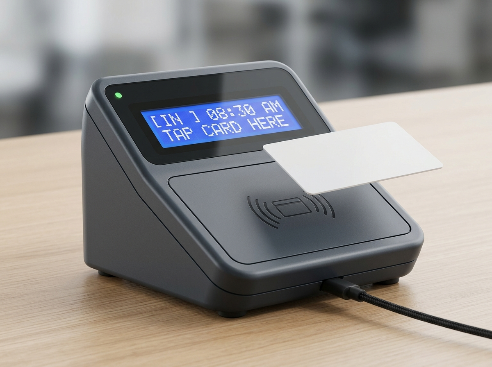
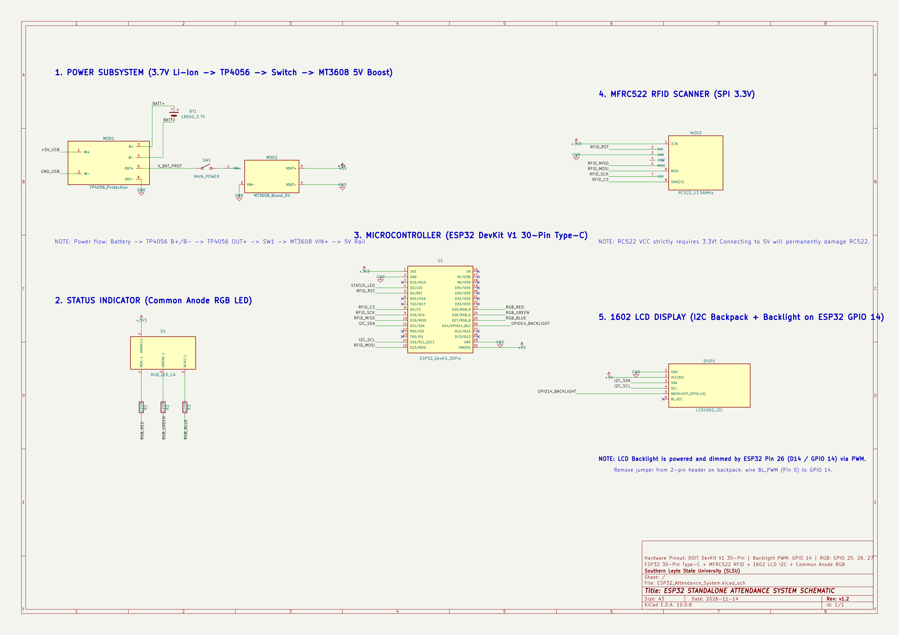

# ESP32 Standalone RFID Attendance System

[](https://www.espressif.com/)
[](https://www.arduino.cc/)
[](Hardware_KiCad/)
[](CAD_Models/)
[](LICENSE)
[](LICENSE)

A standalone, battery-powered RFID attendance terminal built with an **ESP32**, **MFRC522 RFID reader**, **16x2 I2C LCD**, and a **Tricolor RGB LED**. 

The system broadcasts its own **Wi-Fi Access Point** with a **DNS Captive Portal**, serving a modern Material Design web app directly from internal flash memory. **No internet, external router, or battery RTC module required.**

---



---

## ✨ Features

* 🔋 **Battery Powered**: Powered by an 18650 Li-ion battery with integrated USB-C charging and 5V boost power circuit (MH-CD42 / TP4056 + MT3608) with a physical power switch.
* 📱 **Self-Hosted Offline Web App**: Built-in Wi-Fi Hotspot (`ESP32-Attendance`) and DNS Captive Portal (`192.168.4.1`) — automatically prompts login on smartphones and laptops.
* 📋 **Multi-Session Attendance**: Start, pause, resume, and archive multiple attendance sessions stored in flash memory (LittleFS).
* ⏰ **Late Arrival Rule**: Configurable grace period (e.g. 15 mins) that automatically tags late attendees with a **Late** badge on the web console and LCD.
* 🔄 **Strict Deduplication**: Repeated card taps are listed as **ONE entry** — updates IN/OUT timestamps seamlessly with zero duplicate rows.
* 📺 **16x2 I2C LCD Display**: Auto-detects `0x27`/`0x3F` address at 400 kHz Fast-Mode; displays centered `TIME IN` / `TIME OUT` and formatted name (`SURNAME, Initial.`).
* 💡 **Smart PWM Backlight Dimming**: Dims to a faint idle glow when inactive to save battery without leaving the screen pitch black (`GPIO 14` hardware PWM).
* 🚦 **RGB Visual & Audio Feedback**: Color-coded tricolor status LED (Green = Recorded, Amber = Duplicate, Red = Denied) + real-time synthesized web audio chimes.
* 🕒 **1-Click Time Sync (No RTC Module)**: Synchronizes internal crystal clock to your phone or computer browser clock in one click — no coin-battery RTC module needed.
* 💳 **On-Device Tag Enrollment**: Register new student/employee RFID cards in 30 seconds directly through the web interface (saved to NVS Preferences).
* 📥 **Instant CSV Export**: One-click download of attendance session rosters and registered card databases for Excel or Google Sheets.

---

## 📌 Connection Pins

### Clean Pinout Table

| Component | Pin | ESP32 Pin / GPIO | Voltage Level | Notes |
| :--- | :--- | :--- | :---: | :--- |
| **MFRC522 RFID** | **3.3V (VCC)** | **3V3** (Pin 1) | 3.3V | ⚠️ **Connect to 3.3V ONLY! 5V damages the chip.** |
| | **RST** | **GPIO 4** (Pin 5) | 3.3V | Moved to GPIO 4 to free GPIO 22 for I2C SCL |
| | **GND** | **GND** (Pin 2) | 0V | System Ground |
| | **IRQ** | *Not Connected* | -- | Unused (Software polling mode) |
| | **MISO** | **GPIO 19** (Pin 10) | 3.3V | VSPI MISO |
| | **MOSI** | **GPIO 23** (Pin 15) | 3.3V | VSPI MOSI |
| | **SCK** | **GPIO 18** (Pin 9) | 3.3V | VSPI Serial Clock |
| | **SDA (SS)** | **GPIO 5** (Pin 8) | 3.3V | VSPI Chip Select (Active LOW) |
| **I2C 16x2 LCD** | **GND** | **GND** (Pin 29) | 0V | System Ground |
| | **VCC** | **VIN / 5V** (Pin 30) | 5.0V | ⚠️ **Connect to 5V rail for LCD contrast.** |
| | **SDA** | **GPIO 21** (Pin 11) | 3.3V | Hardware I2C Data (400 kHz Fast-Mode) |
| | **SCL** | **GPIO 22** (Pin 14) | 3.3V | Hardware I2C Clock (400 kHz Fast-Mode) |
| | **LED Jumper** | **GPIO 14** (Pin 26) | 3.3V PWM | Remove black jumper shunt, connect to control pin |
| **Tricolor RGB LED** | **Red Cathode** | **GPIO 25** (Pin 23) | 3.3V | Via 220 $\Omega$ resistor (Active LOW) |
| *(Common Anode)* | **Anode (+)** | **3V3** (Pin 1) | 3.3V | Longest lead connects to +3.3V rail |
| | **Green Cathode**| **GPIO 26** (Pin 24) | 3.3V | Via 220 $\Omega$ resistor (Active LOW) |
| | **Blue Cathode** | **GPIO 27** (Pin 25) | 3.3V | Via 220 $\Omega$ resistor (Active LOW) |
| **Status LED** | **Built-in Blue**| **GPIO 2** (Pin 4) | 3.3V | Onboard DevKit LED flashes on card tap |
| **Power Input** | **VIN / 5V** | **VIN** (Pin 30) | 5.0V | From 5V Boost output (via SPST power switch) |

---

## 🔌 Hardware Schematic



> Complete native KiCad 10 / 9 / 8 schematic files, vector PDF sheets, and SVG exports are located in the [`Hardware_KiCad/`](Hardware_KiCad/) folder.

---

## 📁 Repository Structure

```text
ESP32-RFID-Attendance-System/
├── ESP32_RFID_Attendance/        # Arduino Firmware
│   └── ESP32_RFID_Attendance.ino # Main complete firmware sketch
├── CAD_Models/                   # 3D Enclosure Files
│   ├── STLs/                     # 3D printable files (Base, Cover, Switch, Assemblies)
│   ├── Inventor/                 # Autodesk Inventor Assemblies (.iam) & Parts (.ipt)
│   └── STEP/                     # Universal STEP CAD models
├── Hardware_KiCad/               # KiCad Hardware Project
│   ├── ESP32_Attendance_System.kicad_sch
│   ├── ESP32_Attendance_System.kicad_pro
│   └── ESP32_Attendance_System_Schematic_v2.0.pdf
├── assets/                       # Images & schematics for documentation
│   ├── attendance_terminal_enclosure_concept.jpg
│   └── schematic_overall.png
├── .gitignore
├── LICENSE
└── README.md
```

---

## 🚀 Quick Start

### 1. Hardware Requirements
* **ESP32 Dev Module** (30-pin ESP-WROOM-32)
* **MFRC522 RFID Reader** + 13.56 MHz RFID tags/cards
* **16x2 LCD Display with I2C Backpack** (PCF8574)
* **Common Anode RGB LED** + three 220 $\Omega$ resistors
* **18650 Li-ion Battery** + **MH-CD42** (or TP4056 + MT3608) + SPST switch

### 2. Software & Libraries
1. Install **[Arduino IDE](https://www.arduino.cc/)** (version 2.0 or newer).
2. Install the **ESP32** board package:
   * **Preferences** -> Additional boards manager URLs:
     ```text
     https://raw.githubusercontent.com/espressif/arduino-esp32/gh-pages/package_esp32_index.json
     ```
   * **Boards Manager** -> Search `esp32` by **Espressif Systems** -> Install.
3. Install required libraries (**Library Manager** / `Ctrl + Shift + I`):
   * `MFRC522` by GithubCommunity
   * `LiquidCrystal_I2C` by Frank de Brabander

### 3. Flash Firmware
1. Open [`ESP32_RFID_Attendance/ESP32_RFID_Attendance.ino`](ESP32_RFID_Attendance/ESP32_RFID_Attendance.ino).
2. Select **Tools -> Board -> ESP32 Dev Module**.
3. Select your serial COM port.
4. Click **Upload** (`Ctrl + U`).

### 4. How to Use
1. Power on the terminal.
2. Connect your phone or laptop to the Wi-Fi:
   * **SSID:** `ESP32-Attendance`
   * **Password:** `12345678`
3. A captive portal popup will appear automatically (or open your browser to `http://192.168.4.1`).
4. Click **Sync Time Now (1-Click)** to synchronize the clock with your phone.
5. Set direction (**Entrance** or **Exit**), set optional grace period, and start scanning!

---

## 📜 License

This repository is dual-licensed:
* **Firmware & Software (`ESP32_RFID_Attendance/`):** Licensed under the **[MIT License](LICENSE)** (permissive, open for developer use).
* **Hardware & 3D Models (`Hardware_KiCad/`, `CAD_Models/`):** Licensed under **[Creative Commons CC BY-NC 4.0](LICENSE)** (free for personal and academic use; commercial manufacturing or resale requires written permission).
